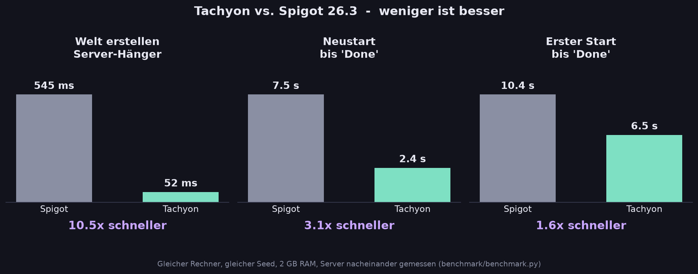
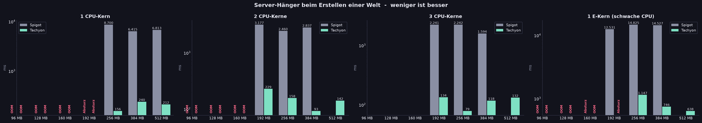

<p align="center">
  
</p>

<h1 align="center">⚡ Tachyon</h1>

<p align="center">
  <b>Minecraft-Server für 26.3 – ohne Lags, mit Turbo-Start und eingebautem World-Manager.</b><br>
  Ein Fork von Spigot, der die Stellen umbaut, an denen der Server dich warten lässt.
</p>

<p align="center">
  
  
  
  
</p>

---

## Warum Tachyon?

Du kennst das: Jemand erstellt eine neue Welt und **der komplette Server friert ein**. Alle Spieler stehen still, Chat hängt, Mobs bleiben stehen. Oder du startest neu und wartest, während in der Konsole hunderte Zeilen durchrattern.

Tachyon räumt damit auf – gemessen, nicht geschätzt:

<p align="center">
  
</p>

| | Spigot 26.3 | **Tachyon** | |
|---|---:|---:|---|
| Server-Hänger beim Erstellen einer Welt | 545 ms | **52 ms** | **10× weniger** |
| Neustart bis „Done“ | 7,5 s | **2,4 s** | **3× schneller** |
| Erster Start bis „Done“ | 10,4 s | **6,5 s** | **1,6× schneller** |
| TPS während eine Welt erstellt wird | 20 | **20** | Server läuft einfach weiter |

> Die Zahlen kommen aus [`benchmark/benchmark.py`](benchmark/benchmark.py) – lass es auf deinem Rechner laufen und überzeug dich selbst.

### 📊 Wenig Leistung, viel Leistung – alle Statistiken

Wie gut kommt Tachyon mit **1, 2 oder 3 CPU-Kernen**, einer **schwachen CPU** und **96 MB bis 8 GB RAM** klar – im direkten Vergleich mit Spigot?

<p align="center"></p>

| | Spigot | Tachyon |
|---|---:|---:|
| Welt erstellen auf **1 schwachen Kern** (kalt) | 12,5 – 14,8 s Hänger | **0,6 – 1,1 s** |
| Welt erstellen auf **1 Kern** (kalt / warm) | 6,4 – 8,7 s / 2,4 s | **0,16 – 0,27 s / 0,32 s** |
| Welt erstellen mit **dem ganzen PC** (kalt / warm) | 1,3 s / 0,31 s | **0,15 s / 0,06 s** |
| Chunks generieren | gleich schnell | gleich schnell |
| Kleinster lauffähiger RAM | 192 – 256 MB | 192 – 256 MB |

➡️ **[Alle Statistiken, Grafiken und Messbedingungen in STATS.md](STATS.md)**

---

## Was Tachyon besser macht

### 🌍 Welten erstellen ohne Freeze
Spigot sucht beim Erstellen einer Welt den Spawnpunkt, indem es **bis zu 121 Chunks direkt auf dem Haupt-Thread generiert**. Solange das läuft, tickt der Server nicht – für alle Spieler.

Tachyon legt die Welt sofort an und sucht den Spawn **im Hintergrund** über Chunk-Tickets. Die eigentliche Generierung läuft auf den Worldgen-Threads, der Server tickt währenddessen ganz normal mit 20 TPS weiter. Sobald der Spawnbereich fertig ist, gilt die Welt als bereit.

### 🧭 World-Manager eingebaut – ohne Plugin
Kein Multiverse nötig. Alles direkt im Server:

| Befehl | Was passiert |
|---|---|
| `/wm create <name> [normal\|flat\|amplified\|large_biomes\|void\|nether\|end] [seed]` | Neue Welt erstellen – ohne Lag |
| `/wm load <name>` | Vorhandenen Weltordner laden |
| `/wm unload <name> [nosave]` | Welt entladen (Spieler werden sicher rausgebracht) |
| `/wm delete <name> confirm` | Welt löschen – die Dateiarbeit läuft im Hintergrund |
| `/wm clone <quelle> <ziel>` | Welt kopieren, perfekt für Minigame-Vorlagen |
| `/wm tp <name> [spieler]` | Teleport – lädt die Welt bei Bedarf und wartet, bis sie bereit ist |
| `/wm pregen <welt> <radius>` | Welt im Hintergrund **vorgenerieren** |
| `/wm list` · `/wm info <name>` · `/wm setspawn` · `/wm autoload <name> <true\|false>` | Übersicht und Verwaltung |

Geladene Welten merkt sich Tachyon in `tachyon.yml` und lädt sie nach einem Neustart automatisch – gestaffelt, nicht alle auf einmal. Jeder Ladevorgang zeigt einen **Live-Ladebalken** unten in der Konsole.

### 🔐 Rechte für jeden Befehl
Nicht jeder soll Welten erstellen oder löschen dürfen. Jeder `/wm`-Befehl hat einen eigenen Permission-Knoten – standardmäßig **nur für OPs**. Mit jedem Permission-Plugin (z. B. LuckPerms) verteilst du sie gezielt:

| Permission | Erlaubt |
|---|---|
| `tachyon.wm.*` | alles |
| `tachyon.wm.create` · `load` · `unload` · `delete` · `clone` | Welten verwalten |
| `tachyon.wm.tp` · `tachyon.wm.tp.others` | Teleport (selbst / andere Spieler) |
| `tachyon.wm.list` · `info` · `setspawn` · `autoload` · `pregen` · `reload` | Übersicht und Werkzeuge |

Wer einen Befehl nicht darf, sieht ihn auch nicht in Hilfe und Tab-Vervollständigung.

### 🧩 API für Plugins
Plugins können den World-Manager direkt nutzen – alles ohne Server-Hänger, mit `CompletableFuture`:

```java
if (TachyonAPI.isAvailable()) {
    TachyonAPI.worlds()
        .createWorld(WorldOptions.builder("arena").type(WorldOptions.Type.VOID).build())
        .thenAccept(world -> player.teleport(world.getSpawnLocation()));
}
```

Dazu: `loadWorld`, `unloadWorld`, `deleteWorld`, `cloneWorld`, `whenReady`, `teleportWhenReady`, `startPregen`, `getManagedWorlds` und das Event **`TachyonWorldReadyEvent`**, sobald eine Welt bereit ist. Zum Kompilieren gegen die API: `build-tachyon` ausführen – es installiert die API (`org.spigotmc:spigot-api:26.3-R0.1-SNAPSHOT` mit Tachyon-Erweiterungen) in dein lokales Maven-Repository.

### 🗺️ Pregenerator, der sich selbst bremst
`/wm pregen world 5000` generiert die Welt im Voraus, damit beim Erkunden nichts mehr ruckelt. Der Pregenerator **pausiert automatisch**, sobald ein Tick länger als 50 ms dauert – Spieler haben immer Vorrang.

### 🚀 Turbo-Start mit Java-AOT-Cache
`Start-Tachyon.bat` / `start-tachyon.sh` nutzen den **AOT-Cache von Java 25+** (Project Leyden). Beim ersten Mal trainiert Tachyon den Cache einmalig (~40 s), danach lädt Java alle Server-Klassen fertig gelinkt aus dem Cache: **Neustart in ~2,5 s statt ~7,5 s**.

Damit das überhaupt geht, startet Tachyon den Server direkt über den Classpath statt über den Spigot-Bootstrap-Classloader – den kann Javas Cache nämlich nicht cachen.

### ⏱️ Kein Warten beim Hochfahren
- **Schnellstart:** Der Server wartet beim Start nicht mehr auf die synchrone Spawnsuche, sondern erledigt sie in den ersten Sekunden nach „Done“ im Hintergrund.
- **Kein Hashen bei jedem Start:** Spigot prüft bei jedem Start sämtliche Bibliotheken per SHA-256. Tachyon merkt sich Größe und Datum und prüft nur, was sich geändert hat.
- **Paralleler Crash-Report-Preload:** Minecraft baut beim Start einen Vorrats-Absturzbericht inklusive langsamer Hardware-Abfrage. Läuft bei Tachyon parallel zum restlichen Start.
- **Kein 20-Sekunden-Zwangswarten:** Spigot wartet bei Builds, die älter als 4 Wochen sind, bei jedem Start 20 Sekunden. Tachyon gibt nur einen Hinweis aus.

### 🔌 Schnelleres Plugin-Laden
- Die `plugin.yml` aller Plugins wird **parallel** gelesen.
- Bibliotheken aus `libraries:` werden für **alle Plugins gleichzeitig** aufgelöst und heruntergeladen – statt Plugin für Plugin nacheinander.
- Reihenfolge, Abhängigkeiten und Fehlermeldungen bleiben exakt wie bei Spigot. Klappt das parallele Laden mal nicht, fällt Tachyon auf den normalen Weg zurück.

### 🖥️ Konsole, die Spaß macht
- Farbiges Banner und **ein einziger Ladebalken**, der sich live aktualisiert – statt hunderter Log-Zeilen.
- **Kein Spam:** Beim Start erscheinen nur Warnungen und Fehler. Die 30 Zeilen „World Settings“ pro Welt, „Saving chunks…“ und ähnliche Routine laufen nur noch ins Logfile.
- **Live-Balken im Betrieb:** Welt laden, Welt erstellen und `/wm pregen` zeigen einen Fortschrittsbalken unten in der Konsole – du kannst währenddessen weiter tippen. Am Ende bleibt genau eine Zeile: „✔ Welt 'arena' bereit“.
- Am Ende des Starts eine **Zusammenfassung**: Startzeit, Port, Slots, Whitelist, Welten, Plugins, RAM und ob es Probleme gab.
- Eingefärbte Logs: Joins grün, Leaves gelb, Befehle lila, Warnungen gelb, Fehler rot.
- Funktioniert im Windows Terminal und im klassischen Konsolenfenster. In Hosting-Panels automatisch schlichter Text. `-Dtachyon.verboseStartup=true` bringt das klassische Log zurück.

### 🌐 Deutsch oder Englisch
Beim ersten Start fragt Tachyon in der Konsole nach der Sprache. Alle Tachyon-Texte – Konsole, Ladebalken, Zusammenfassung, `/wm`, `/tps`, Startdatei – folgen dieser Wahl. Ändern: `language: de` oder `language: en` in `tachyon.yml`.

### ✅ EULA direkt in der Konsole
Kein „eula.txt bearbeiten und neu starten“ mehr: Tachyon fragt beim ersten Start „EULA akzeptieren? (ja/nein)“ und **startet direkt weiter**.

### 📊 `/tps` und Befehle im Look großer Server
`/tps` zeigt TPS (1/5/15 min), MSPT inklusive Spitzenwert, RAM, **CPU-Last von Server und System, aktive Worker-Threads** und wie Tachyon die Ressourcen **dynamisch** steuert (RAM-Bereich, gerade reserviert, Rückgabe im Leerlauf, Lastregelung, ausgelagerte Welten) – mit Farbverlauf-Präfix, Balken und Ampelfarben. Alle Tachyon-Meldungen nutzen denselben Stil.

### 🧠 Dynamische Leistung
In `Start-Tachyon.bat` legst du einen **Bereich** fest – `RAM_MIN`, `RAM_MAX` und optional `CPU_MAX`. Der Server startet klein, holt sich Speicher, wenn er ihn braucht, und **gibt ihn im Leerlauf wieder ans System zurück** (periodische, nebenläufige G1-Läufe – ohne Pausen im Spiel). Ohne Spieler pausiert Minecraft außerdem das Ticken (`pause-when-empty-seconds`).

### 💤 Leere Welten wandern auf die SSD
Welten des World-Managers, in denen seit 10 Minuten niemand war, werden gespeichert und aus dem RAM genommen – auch wenn der Server ohne Spieler pausiert. Sobald jemand hin will (`/wm tp`, `/wm load` oder die Plugin-API), lädt Tachyon sie **ohne Server-Hänger** wieder (im Test: bereit nach 0,3 s). Standard- und Plugin-Welten bleiben unberührt. Einstellbar mit `world-manager.unload-idle-minutes` (0 = aus).

> Warum nicht einfach Arbeitsspeicher auf die SSD auslagern wie manche KI-Modelle? Weil ein Server alle 50 ms einen Tick fertig haben muss und kreuz und quer auf den Speicher zugreift – Auslagern (Swap) würde aus GC-Pausen von Millisekunden Sekunden machen. Ganze ungenutzte Welten auszulagern spart RAM ohne dieses Risiko.

### ⚖️ Lastregelung gegen Lags
Steigt die Tick-Zeit Richtung 50 ms (= Lag), verkleinert Tachyon automatisch und schrittweise die **Simulationsdistanz** – also den Bereich um Spieler, in dem Mobs, Redstone und Pflanzen berechnet werden. Die Sichtweite bleibt gleich. Ist wieder Luft, geht es schrittweise zurück auf deinen Wert. `/tps` zeigt den aktuellen Stand. Einstellbar unter `performance` in `tachyon.yml` (Untergrenze und Schwellen).

### 📦 Weniger Item- und XP-Entities
Drops werden in einem größeren Radius zusammengefasst (Items 3,5 statt 2,5 Blöcke, XP 4,0 statt 3,0). Gerade bei Farmen heißt das deutlich weniger Entities pro Tick.

### 🛠️ Fixes und Aufräumarbeiten
- **Bugfix:** Spigot wirft beim Stoppen `AsyncStructureSpawnEvent cannot be triggered asynchronously from primary server thread`, wenn gerade noch Chunks generiert werden – das Herunterfahren schlägt dann fehl. Behoben.
- **Whitelist standardmäßig aus:** Minecraft 26.x schaltet sie bei neuen Servern ein – dann kommt erstmal niemand rein.
- **Sinnvolle Standards:** 100 Slots, MOTD „Powered by Tachyon“, eigenes Server-Icon.
- **MCStats raus:** Das uralte Statistik-System von 2013 meldet sich nicht mehr im Hintergrund.
- **Startdateien ohne veraltete JVM-Flags:** `ParallelRefProcEnabled` (in Java 26 abgekündigt) entfernt, dafür **Compact Object Headers** aus Java 25 für weniger RAM pro Objekt.

---

## Ehrlich gesagt: was *nicht* schneller wurde

Tachyon soll nicht mehr versprechen, als es hält:

- **Tick-Zeit (MSPT), TPS und RAM im normalen Betrieb** sind praktisch gleich wie bei Spigot. Der Main-Thread macht dieselbe Arbeit – Tachyon nimmt ihm nur die blockierenden Brocken ab.
- **Event-System:** Ein Umbau ohne Reflection brachte auf Java 26 nichts Messbares und wurde deshalb wieder entfernt.
- **„Welt bereit“** dauert bei Tachyon etwas länger (1,5–2 s statt 0,5 s), weil der Spawnbereich vorgeladen wird – dafür läuft der Server währenddessen ohne Hänger weiter.

---

## Installation

> **Warum gibt es keine fertige Jar zum Download?**
> Die Server-Jar enthält den Minecraft-Server-Code von Mojang, und den darf niemand weiterverbreiten. Genau deshalb gibt es bei Spigot BuildTools. Tachyon macht es genauso: Du baust die Jar mit einem Doppelklick selbst – das Ergebnis ist identisch.

### Voraussetzungen
- **Java 25 oder neuer** (z. B. [Adoptium](https://adoptium.net))
- **Git** ([git-scm.com](https://git-scm.com))
- ca. 5–10 Minuten und Internet

### Bauen
```bash
git clone https://github.com/Balanceakt/tachyon.git
cd tachyon
```
- **Windows:** `build-tachyon.bat` doppelklicken
- **Linux/macOS:** `./build-tachyon.sh`

Das Skript lädt BuildTools, baut Spigot 26.3 (Build 4664), spielt die Tachyon-Patches ein und legt `tachyon-26.3.jar` daneben.

### Starten
1. `tachyon-26.3.jar` und `Start-Tachyon.bat` (bzw. `start-tachyon.sh`) in deinen Server-Ordner legen.
2. Starten. Tachyon fragt nach der Sprache und nach der Minecraft-EULA – einfach in der Konsole antworten, der Server startet direkt weiter.
3. Ab dem zweiten Start trainiert Tachyon einmalig den Start-Cache – danach geht's in Sekunden.

Leistung einstellen: oben in `Start-Tachyon.bat` `RAM_MIN`, `RAM_MAX` und `CPU_MAX` anpassen (bei `start-tachyon.sh`: `RAM_MAX=8G CPU_MAX=4 ./start-tachyon.sh`).

**Plugins:** Tachyon ist ein Spigot-Fork – Bukkit- und Spigot-Plugins laufen wie gewohnt.

---

## Konfiguration (`tachyon.yml`)

```yaml
language: de                                # de oder en
startup:
  fast-start: true                          # nicht auf die Spawnsuche warten
world-manager:
  fast-world-creation-for-plugins: false    # true = auch Plugin-Welten (z.B. Multiverse) ohne Hänger
  spawn-preload-radius: 2                   # Chunks um den Spawn, die vor "bereit" geladen werden
  autoload-interval-ticks: 20               # Abstand beim automatischen Laden nach dem Start
  pregen-parallel-chunks: 40                # gleichzeitige Chunks bei /wm pregen
  unload-idle-minutes: 10                   # leere Welten nach X Minuten auf die SSD auslagern (0 = aus)
performance:
  dynamic-simulation-distance: true         # unter Last Simulationsdistanz senken, danach wieder anheben
  min-simulation-distance: 4                # nie weiter runter als das
  mspt-high: 40.0                           # ab so vielen ms pro Tick wird gedrosselt
  mspt-low: 25.0                            # darunter geht es wieder hoch
```

---

## Benchmark selbst ausführen

```bash
cd benchmark
python benchmark.py --original pfad/zu/spigot-26.3.jar --tachyon pfad/zu/tachyon-26.3.jar
```

Startet beide Server nacheinander in eigenen Testordnern (gleicher Seed, gleiche Einstellungen) und misst Startzeiten, Hänger beim Welterstellen, Tick-Zeiten, Events und RAM. Am Ende gibt es eine Tabelle und einen Bericht in `benchmark/ergebnisse/`.

---

## Aufbau des Repos

| Pfad | Inhalt |
|---|---|
| `patches/tachyon-server.patch` | Alle Änderungen am Server (World-Manager, Rechte, Sprachen, Konsole, Start, Fixes) |
| `patches/tachyon-api.patch` | Tachyon-API für Plugins, paralleles Plugin-Laden, Event-Fix |
| `build-tachyon.bat` / `.sh` | Baut die Jar lokal |
| `Start-Tachyon.bat` / `start-tachyon.sh` | Startdateien mit AOT-Cache und G1-Tuning |
| `benchmark/` | Vergleichs-Benchmark inkl. Mess-Plugin |

---

## Lizenz & Hinweise

Die Patches bauen auf [Spigot](https://www.spigotmc.org) / CraftBukkit / Bukkit auf und stehen wie diese unter der **GPL-3.0** (siehe [LICENSE](LICENSE)).
Tachyon ist kein offizielles Produkt von Mojang, Microsoft oder SpigotMC und steht mit ihnen in keiner Verbindung. Minecraft ist eine Marke von Mojang AB.
