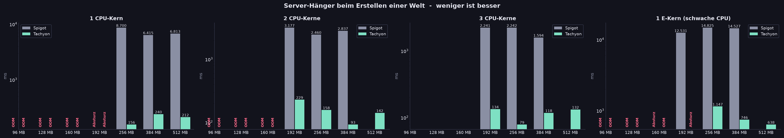
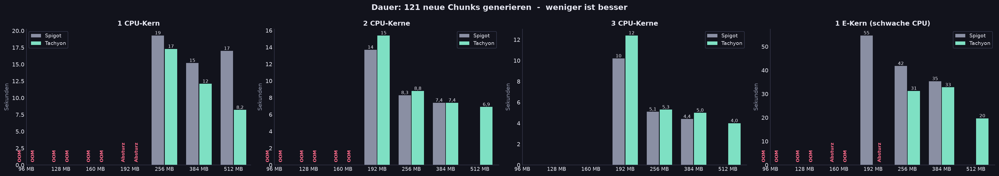
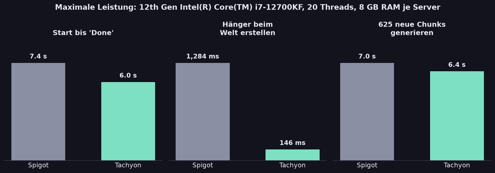

# 📊 Tachyon vs. Spigot – Statistiken

Wie schlägt sich Tachyon gegen den originalen Spigot, wenn es eng wird, und wenn es gar nicht eng ist?
Getestet mit **1, 2 und 3 CPU-Kernen**, einem **schwachen Effizienz-Kern** (vergleichbar mit einem günstigen VPS), **RAM von 96 MB bis 8 GB** und einmal mit **dem kompletten PC**.

> **Kurz gesagt:** Beim Erstellen von Welten hängt Tachyon **10- bis 40-mal kürzer** als Spigot – auf jeder Hardware. Auf schwachen CPUs startet Tachyon schneller und generiert Chunks bis zu doppelt so schnell. Mit mehr Kernen holt Spigot beim reinen Chunk-Generieren auf. Den minimalen RAM schaffen beide fast gleich – und das schreiben wir ehrlich dazu.

---

## Welt erstellen: wie lange hängt der Server?

Während eine neue Welt erstellt wird, friert Spigot den kompletten Server ein – kein Spieler kann sich bewegen. Tachyon erledigt die Arbeit im Hintergrund.

| Hardware | Spigot | Tachyon | Faktor |
|---|---:|---:|---:|
| 1 E-Kern (schwache CPU) | 12,5 – 14,8 s | **0,6 – 1,1 s** | **~15–20×** |
| 1 CPU-Kern | 6,4 – 8,7 s | **0,16 – 0,27 s** | **~30–40×** |
| 2 CPU-Kerne | 2,5 – 3,2 s | **0,09 – 0,23 s** | **~15–30×** |
| 3 CPU-Kerne | 1,6 – 2,2 s | **0,08 – 0,13 s** | **~15–28×** |
| Ganzer PC (20 Threads) | 1,3 s | **0,15 s** | **~9×** |

## Chunks generieren: wie schnell entsteht neues Gelände?

121 noch nie generierte Chunks laden – so wie Spieler, die neues Gelände erkunden.

- **Schwache Hardware:** Tachyon ist klar schneller – auf einem E-Kern **19,7 s statt 35,4 s**, auf einem P-Kern mit 512 MB **8,2 s statt 17,0 s**.
- **Ab 2 Kernen:** beide etwa gleich schnell (z. B. 3 Kerne / 384 MB: 4,4 s vs. 5,0 s, bei 192 MB war Spigot sogar etwas schneller). Mehr Kerne gleichen Spigots Nachteil aus – ehrlich gesagt hat Tachyon hier keinen Vorsprung.

## Minimaler RAM: wie klein geht es?

Kleinste RAM-Stufe, bei der der Server startet, eine Welt erstellt **und** 121 Chunks generiert:

| Hardware | Spigot | Tachyon |
|---|---:|---:|
| 1 CPU-Kern | 256 MB | 256 MB |
| 2 CPU-Kerne | 192 MB | 192 MB |
| 3 CPU-Kerne | 192 MB | 192 MB |
| 1 E-Kern (schwache CPU) | **192 MB** | 256 MB |

Gleichstand – bis auf den schwachen E-Kern, wo Spigot mit 192 MB noch durchkommt und Tachyon 256 MB braucht. Unter 160 MB scheitern beide („Speicher voll“).
Tachyon passt sich an: Unter ~400 MB lädt es beim Erstellen einer Welt nur noch den Spawn-Chunk vor statt 5×5 Chunks – das hat die 192-MB-Stufe bei 2 und 3 Kernen erst möglich gemacht.

## Maximale Leistung

| Ganzer PC | Spigot | Tachyon |
|---|---:|---:|
| Start bis „Done“ | 7,4 s | **6,0 s** |
| Hänger beim Welt erstellen | 1.284 ms | **146 ms** |
| 625 neue Chunks generieren | 7,0 s | **6,4 s** |
| Leerlauf (ms pro Tick) | 0,18 ms | 0,18 ms |
| Heap nach GC / Prozess gesamt | 2.463 MB / 4.226 MB | 2.380 MB / 4.342 MB |

---

## Alle Messwerte

### 1 CPU-Kern

| RAM | Spigot: Welt erstellen | Tachyon: Welt erstellen | Spigot: 121 Chunks | Tachyon: 121 Chunks | Spigot: Start | Tachyon: Start |
|---:|---:|---:|---:|---:|---:|---:|
| 96 MB | ❌ OOM | ❌ OOM | ❌ OOM | ❌ OOM | ❌ OOM | ❌ OOM |
| 128 MB | ❌ OOM | ❌ OOM | ❌ OOM | ❌ OOM | 24,3 s | 23,4 s |
| 160 MB | 7.199 ms | ❌ OOM | ❌ OOM | ❌ OOM | 22,5 s | 19,9 s |
| 192 MB | 7.525 ms | 268 ms | ❌ Absturz | ❌ Absturz | 25,8 s | 22,0 s |
| 256 MB | 8.700 ms | 156 ms | 19,3 s | 17,3 s | 28,0 s | 20,8 s |
| 384 MB | 6.415 ms | 240 ms | 15,2 s | 12,1 s | 25,3 s | 21,5 s |
| 512 MB | 6.813 ms | 212 ms | 17,0 s | 8,2 s | 24,3 s | 20,8 s |

### 2 CPU-Kerne

| RAM | Spigot: Welt erstellen | Tachyon: Welt erstellen | Spigot: 121 Chunks | Tachyon: 121 Chunks | Spigot: Start | Tachyon: Start |
|---:|---:|---:|---:|---:|---:|---:|
| 96 MB | ❌ OOM | ❌ OOM | ❌ OOM | ❌ OOM | ❌ OOM | ❌ OOM |
| 128 MB | ❌ OOM | ❌ OOM | ❌ OOM | ❌ OOM | 14,3 s | 13,8 s |
| 160 MB | 4.623 ms | 193 ms | ❌ OOM | ❌ OOM | 13,6 s | 10,8 s |
| 192 MB | 3.177 ms | 229 ms | 13,7 s | 15,4 s | 13,6 s | 9,8 s |
| 256 MB | 2.460 ms | 158 ms | 8,3 s | 8,8 s | 11,7 s | 9,7 s |
| 384 MB | 2.837 ms | 93 ms | 7,4 s | 7,4 s | 10,4 s | 9,0 s |
| 512 MB | 2.622 ms | 163 ms | 7,3 s | 6,6 s | 9,7 s | 9,7 s |

### 3 CPU-Kerne

| RAM | Spigot: Welt erstellen | Tachyon: Welt erstellen | Spigot: 121 Chunks | Tachyon: 121 Chunks | Spigot: Start | Tachyon: Start |
|---:|---:|---:|---:|---:|---:|---:|
| 192 MB | 2.241 ms | 134 ms | 10,2 s | 12,4 s | 8,3 s | 7,6 s |
| 256 MB | 2.242 ms | 79 ms | 5,1 s | 5,3 s | 8,6 s | 6,8 s |
| 384 MB | 1.594 ms | 118 ms | 4,4 s | 5,0 s | 7,4 s | 6,6 s |
| 512 MB | – | 132 ms | – | 4,0 s | – | 6,4 s |

### 1 E-Kern (schwache CPU)

| RAM | Spigot: Welt erstellen | Tachyon: Welt erstellen | Spigot: 121 Chunks | Tachyon: 121 Chunks | Spigot: Start | Tachyon: Start |
|---:|---:|---:|---:|---:|---:|---:|
| 96 MB | ❌ OOM | ❌ OOM | ❌ OOM | ❌ OOM | ❌ OOM | ❌ OOM |
| 128 MB | ❌ OOM | ❌ OOM | ❌ OOM | ❌ OOM | 59,8 s | 42,9 s |
| 160 MB | 14.265 ms | ❌ OOM | ❌ Absturz | ❌ OOM | 62,9 s | 44,1 s |
| 192 MB | 12.531 ms | 591 ms | 54,7 s | ❌ Absturz | 55,1 s | 40,5 s |
| 256 MB | 14.825 ms | 1.147 ms | 41,8 s | 31,3 s | 59,8 s | 44,4 s |
| 384 MB | 14.527 ms | 746 ms | 35,4 s | 32,8 s | 60,5 s | 45,8 s |
| 512 MB | – | 638 ms | – | 19,7 s | – | 41,9 s |

„–“ = nicht mehr gemessen (pro Server wurde nach drei bestandenen Stufen aufgehört).

---

## So wurde gemessen

| | |
|---|---|
| **Rechner** | Intel Core i7-12700KF (8 P-Kerne + 4 E-Kerne, 20 Threads), 32 GB RAM, Windows 11 |
| **Java** | OpenJDK 26 |
| **Versionen** | Spigot 26.3 (Build 4664, unverändert) vs. Tachyon 26.3 |
| **CPU-Grenze** | Prozess per Windows-Affinität auf feste Kerne genagelt + `-XX:ActiveProcessorCount=<n>`. Parallel laufende Tests lagen immer auf **getrennten physischen Kernen**; Spigot und Tachyon liefen zeitgleich unter denselben Bedingungen. |
| **RAM-Grenze** | `-Xms` = `-Xmx` = Stufe (96 MB … 512 MB) |
| **JVM bei den Low-Resource-Tests** | JVM-Standard für beide – keine Tuning-Flags, kein AOT-Cache. Verglichen wird nur der Server-Code. |
| **JVM beim Maximal-Test** | Jeder Server allein auf dem ganzen PC, nacheinander, `-Xms8192M -Xmx8192M` plus identisch für beide: `-XX:+UseG1GC -XX:MaxGCPauseMillis=200 -XX:+UnlockExperimentalVMOptions -XX:+DisableExplicitGC -XX:G1NewSizePercent=30 -XX:G1MaxNewSizePercent=40 -XX:G1HeapRegionSize=8M -XX:G1ReservePercent=20 -XX:G1HeapWastePercent=5 -XX:G1MixedGCCountTarget=4 -XX:InitiatingHeapOccupancyPercent=15 -XX:G1MixedGCLiveThresholdPercent=90 -XX:G1RSetUpdatingPauseTimePercent=5 -XX:SurvivorRatio=32 -XX:+PerfDisableSharedMem -XX:MaxTenuringThreshold=1 -XX:+UseCompactObjectHeaders` (ohne AOT-Cache) |
| **Welt** | gleicher Seed, vorher einmal erzeugt und vor jedem Lauf zurückgesetzt |
| **Ablauf pro Stufe** | Start → 10 s Leerlauf → neue Welt erstellen → 121 neue Chunks (Maximal-Test: 625) → RAM messen |
| **Werkzeuge** | [`benchmark/lowres.py`](benchmark/lowres.py), Mess-Plugin [`benchmark/bench-plugin`](benchmark/bench-plugin), Grafiken: [`benchmark/make_stats.py`](benchmark/make_stats.py) |

**Gegenprobe bei ruhendem PC**
Weil während der Tests nebenbei am PC gearbeitet wurde, habe ich den auffälligsten Wert noch einmal gemessen, während der PC nichts anderes tat:

| 1 CPU-Kern · 512 MB | erster Lauf | Gegenprobe |
|---|---:|---:|
| Spigot: 121 Chunks | 17,0 s | 17,3 s |
| Tachyon: 121 Chunks | 8,2 s | 8,9 s |
| Spigot: Welt erstellen | 6.813 ms | 5.363 ms |
| Tachyon: Welt erstellen | 212 ms | 256 ms |

Die Abweichungen liegen bei wenigen Prozent – die Ergebnisse sind reproduzierbar. Warum Tachyon auf *einem* Kern beim Chunk-Test doppelt so schnell ist, ist noch nicht sicher geklärt. Vermutung: Spigot generiert beim Welt-Erstellen bis zu 121 Spawn-Chunks synchron, deren Speichern danach auf dem einzigen Kern mit dem Chunk-Test konkurriert. Ab 2 Kernen sind beide gleichauf. Die 2-Kern/512-MB-Zeile stammt aus der Gegenprobe.

**Hinweise zur Ehrlichkeit**
- Beim Chunk-Test fordert das Mess-Plugin Chunks über die Plugin-API an. Diese lädt bei **beiden** Servern synchron, deshalb ist dort die *Dauer* aussagekräftig, nicht die TPS.
- Die Tachyon-Werte bis 384 MB stammen vom aktuellen Build mit adaptivem Vorladen; die 512-MB-Werte vom vorherigen Build (oberhalb von ~400 MB verhalten sich beide gleich).
- Startzeiten schwanken je nach Festplatten-Cache und Hintergrundlast um einige Prozent; auf meinem PC lief nebenbei noch ein Tachyon-Server mit Spielern auf den freien Kernen.

**Selbst messen:** `python benchmark/lowres.py` (1 und 2 Kerne), `--cores3`, `--ecores` (Kernnummern ggf. an deine CPU anpassen), `--max`, danach `python benchmark/make_stats.py`.
